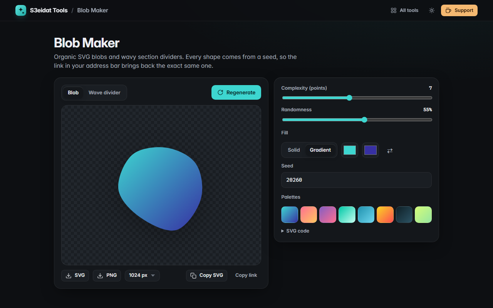

# Blob Maker

> Random organic SVG blobs and wave section dividers. Free, private, and it runs entirely in your browser.

### ▶ [Open Blob Maker](https://s3eidat.github.io/blob-maker/)



## Features

- **Blob mode**: complexity (3–12 points) and randomness sliders, smooth closed curves
- **Wave divider mode**: number of waves, randomness, 1–4 stacked layers with fading opacity, flip for the top of a section
- **Solid or gradient fill**, color pickers, swap, and 8 palettes
- **Seeded**: every shape comes from a seed stored in the URL (`#seed=…&n=…`), so a link reproduces it exactly
- **Export SVG** or **PNG** (512–4096 px wide), **copy the SVG code**, copy a link to the shape
- Clean, small SVG output (one `<path>` per shape, coordinates rounded to 0.1)

## Privacy

Nothing you make leaves your device. There is no server, no account, no analytics.
The page ships with a strict Content-Security-Policy (`connect-src 'self'`), so the browser
itself blocks any attempt to send data anywhere.

## Run it yourself

It's plain HTML, CSS and JavaScript with no build step:

```bash
git clone https://github.com/s3eidat/blob-maker
cd blob-maker
python -m http.server 8000
```

Then open http://localhost:8000.

## Support

If this saved you time, **[buy me a coffee ☕](https://s3eidat.github.io/coffee/)**. It keeps every tool free.

---

Part of **[S3eidat Tools](https://s3eidat.github.io/)**: 100+ free, private tools that run in your browser. MIT licensed.
